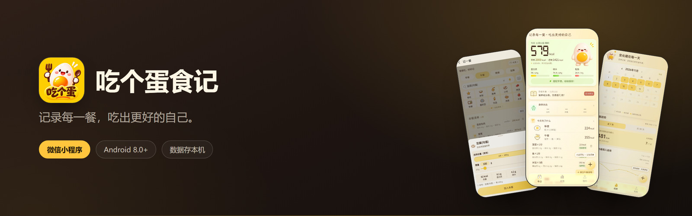
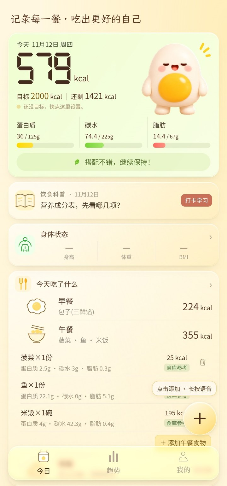
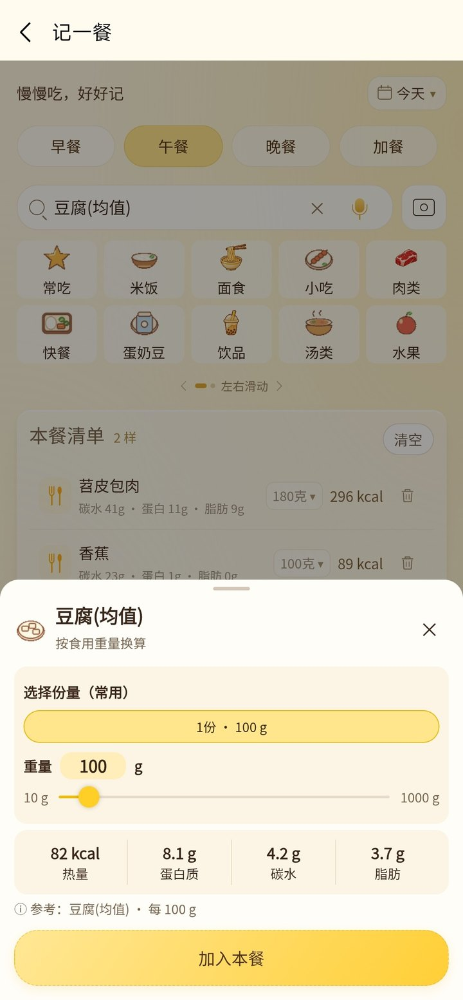
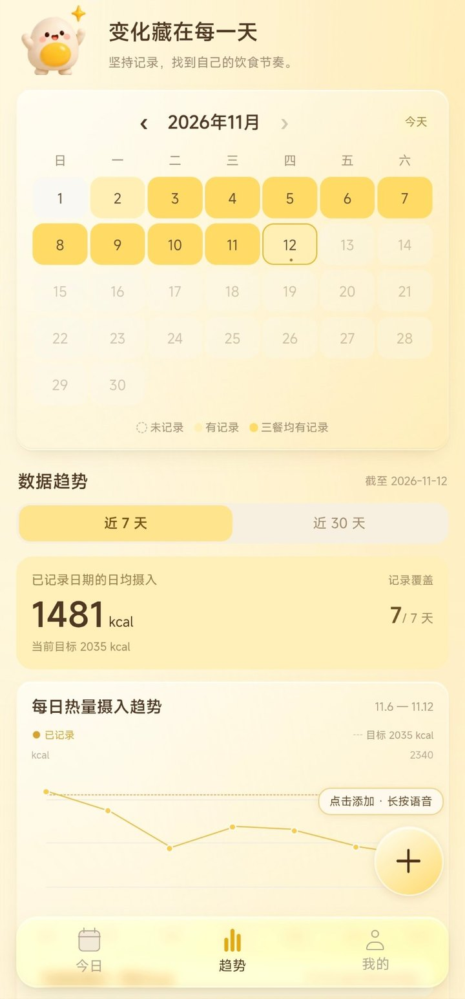

<p align="center">
  
</p>

<p align="center">
  <a href="https://github.com/wzsheen/Chigedan/releases/latest"><b>下载 Android 版</b></a>
  &nbsp;·&nbsp;
  <a href="#快速开始">自己跑起来</a>
  &nbsp;·&nbsp;
  <a href="https://github.com/wzsheen/Chigedan/issues">反馈问题</a>
</p>

<p align="center">
  
  
  
  
</p>

吃个蛋食记是一款**本地优先**的饮食记录小程序。拍一张照、或者说一句「两个包子一杯豆浆」，就能记下一餐；热量、蛋白质、碳水、脂肪自动结算，剩下的额度当场就能看见。

不用注册，不用登录，饮食记录只存在你自己的手机里。

## 截图

| 今日 | 记一餐 | 趋势 |
| :---: | :---: | :---: |
|  |  |  |
| 目标、剩余、三大营养素<br>一屏看完 | 搜食物、调份量<br>核对清单再保存 | 日历热力图<br>与 7 / 30 天曲线 |

## 功能

**记一餐**

- 本地食物库分类浏览：常吃、米饭、面食、小吃、肉类、快餐、蛋奶豆、饮品、汤类、水果、薯类、蔬菜菌藻、零食甜点、坚果
- 选中后按重量或份量换算，热量与三大营养素同步计算，不用自己查表
- 先攒成一餐的清单，能改能删，核对完才写入记录——不会因为识别错一样东西就把整天数据带偏
- 拍照识别、语音记账：需要自己配置 AI 服务（见「AI 识别」），识别结果一律先落到草稿，人工确认后才保存

**今日**

- 目标、已摄入、剩余额度实时结算
- 蛋白质 / 碳水 / 脂肪三条进度，缺口一眼看到
- 早午晚分餐次列清单，每样带克数与热量
- 饮水打卡、身体状态、每日饮食科普

**趋势**

- 日历热力图，记录断在哪天看得很清楚
- 近 7 天、近 30 天摄入曲线可切换，日均摄入对标基准
- 体重、腰围、臀围的变化曲线单独看

**身体与计划**

- 身高、体重、腰围、臀围分开记录，各字段保留自己的测量日期
- BMI、腰高比等指标，只作成人参考
- 按个人资料和活动水平算出热量、营养、饮水计划，支持「只记体重」模式
- 今日建议、食谱库、饮食科普文章与小测试

**数据**

- 一键导出、导入 JSON，完整还原；也支持文本格式的部分数据迁移
- 清空数据需要二次确认，不给误触机会

## AI 识别（可选）

拍照和语音识别不是内置服务，也不走任何自建服务器。你需要自己申请模型厂商的 API Key，在「AI 设置」里填进去，请求直接由手机发往该厂商。

不配置也完全能用，手动搜索、称重记录是完整功能，不依赖 AI。

## 技术栈

| 项目 | 说明 |
| --- | --- |
| 运行时 | 微信小程序原生（`App` / `Page` / `Component`） |
| 语言 | JavaScript（CommonJS）+ WXML + WXSS |
| 存储 | `wx.storage` 本地存储，无数据库、无自有后端 |
| 依赖 | **无 npm 依赖，无构建步骤** |
| Android | 微信开发者工具「多端应用」打包，签名后分发 APK |
| 测试 | Node 内置测试器 + `wx` mock，`node --test tests/*.test.js` |
| 主题 | `theme.json` 支持系统深色模式 |

## 目录结构

```
├── app.js / app.json / app.wxss   启动、路由、全局样式
├── theme.json                     深色模式变量
├── pages/                         19 个页面：今日、记一餐、计划、趋势、我的……
├── components/
│   ├── app-dock/                  底部导航、独立添加按钮、长按录音
│   ├── body-editor/               身体数据编辑
│   └── egg-static/                形象与动画
├── utils/                         存储、营养计算、识别、统计、建议
├── assets/                        图标、形象、字图、食物图标
├── scripts/                       数据构建脚本与来源说明（非运行时依赖）
├── tests/                         Node 测试
└── miniapp/android/               多端打包的原生配置
```

## 快速开始

**环境**：微信开发者工具，无需 Node 也能运行。

```bash
git clone https://github.com/wzsheen/Chigedan.git
```

1. 打开微信开发者工具 →「导入项目」→ 选择仓库根目录
2. AppID 填自己的，或直接用测试号
3. 编译即可运行

项目**没有 `npm install`，也没有构建命令**，导入就能跑。

跑测试需要 Node 18 以上：

```bash
node --test tests/*.test.js
```

## Android 版

APK 通过 [GitHub Releases](https://github.com/wzsheen/Chigedan/releases/latest) 分发，需要 Android 8.0 及以上。

自行打包的流程见 [`scripts/ANDROID_RELEASE.md`](scripts/ANDROID_RELEASE.md)：用微信开发者工具的多端打包功能生成 Release 构建，自行签名后安装。仓库里不包含 Gradle 工程，也不提供自动打包流水线。

应用内的更新检查只做版本比对与下载提示，不静默安装。

## 数据说明

营养数值来自三类来源，精度不一样，用之前值得知道：

| 来源 | 规模 | 性质 |
| --- | --- | --- |
| USDA SR Legacy | 38 项基础食物 | 公开数据库参考值 |
| 重庆地域菜肴 | 80 余项 | 按常见配方做的**估算** |
| 饮料 | 常见品类 | 参考值 |

用户自己确认过的食物会进入个人库（上限 500 条），优先于内置数据。**这些数字用于日常参考，不是实验室检测结果**，不同做法、不同店家差异很大。

## 隐私

- 饮食、身体、饮水记录只保存在本机，不上传、不同步
- 没有账号体系，也就没有服务器端数据
- 唯一的外发请求是你自己配置的 AI 厂商接口，以及 GitHub 上的版本检查
- 卸载或清空数据后无法找回，请先导出备份

## 免责声明

本项目是个人饮食记录工具，不构成医疗、营养或诊疗建议。BMI、腰高比、热量目标等均为成人通用参考值，孕期、哺乳期、未成年人和有基础疾病的人群请遵医嘱。

## 反馈

发现问题或想加功能，欢迎提 [Issue](https://github.com/wzsheen/Chigedan/issues)。提交前麻烦说明机型和系统版本，如果能附上复现步骤会快很多。

## 许可

代码以 [MIT 许可证](LICENSE) 授权，可自由使用、修改、分发，包括商业用途，保留版权声明即可。

**数据部分有例外。** `utils/china-food-data.js` 中相当一部分条目标注来源为《中国食物成分表》第 6 版（杨月欣主编，北京大学医学出版社），该数据汇编的著作权归原出版方，不在本项目的 MIT 授权范围内，此处仅供 App 功能演示。`utils/beverage-data.js` 来自 USDA SR Legacy，属公有领域，可自由使用。如果你要在自己的项目里使用这些营养数据，请自行取得相应授权。
